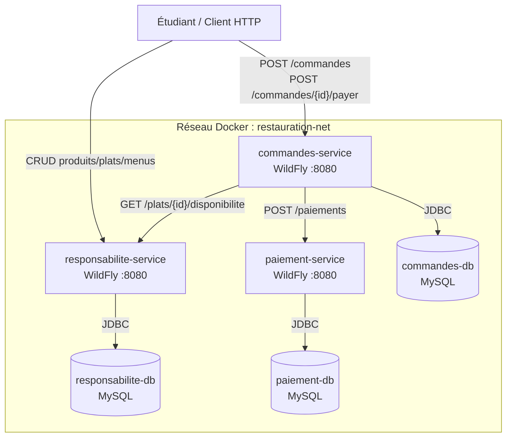
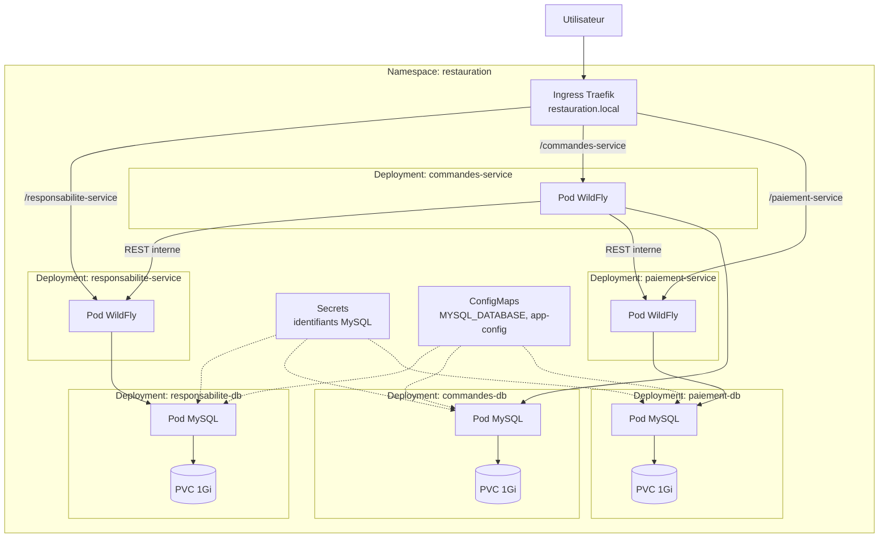
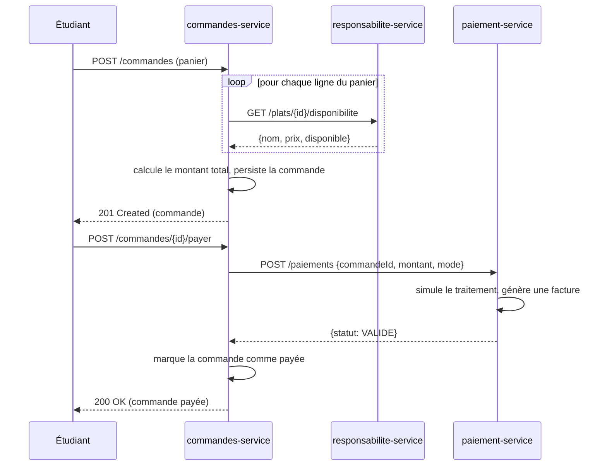

# Diagramme d'architecture — Projet 5 : Restauration universitaire

Ce fichier peut être ouvert dans un artefact Markdown (rendu Mermaid automatique)
ou collé dans le rapport Word/LaTeX (les outils comme draw.io, Zotero+LaTeX ou
même une capture d'écran depuis un rendu Mermaid en ligne acceptent ce format).

## Vue d'ensemble Phase 2 (Docker Compose)

## Vue d'ensemble Phase 4 (Kubernetes / K3s)

## Séquence du scénario métier principal

